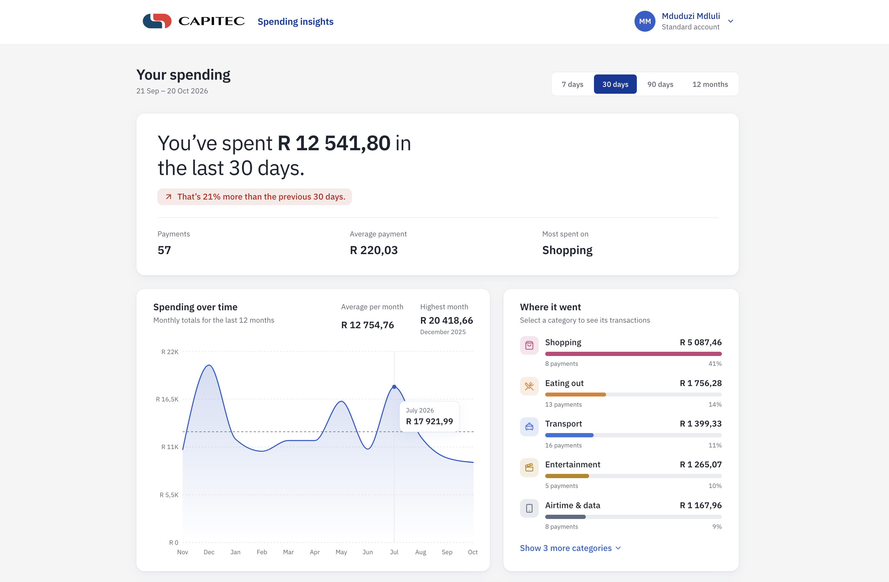
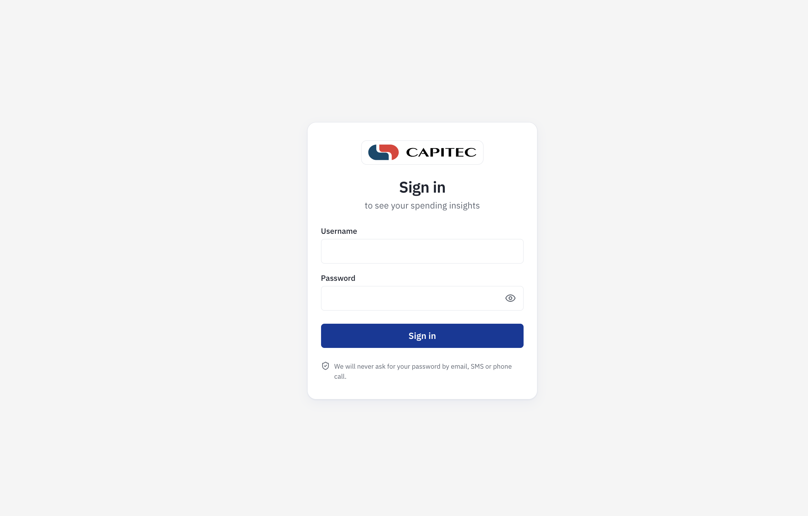

# Customer Spending Insights Dashboard

A responsive financial analytics dashboard that shows a customer where their money goes: how much they've spent and how that compares with before, how spending changes month to month, which categories it goes to, how they're tracking against their budgets, and every transaction behind it. It implements all seven endpoints in the API document provided with the brief, against a mock backend.



## Quick start

The only requirement is [Docker](https://www.docker.com/products/docker-desktop/).

```bash
git clone https://github.com/Mduduzmdluli/capitec-spending-insights.git
cd spending-insights
docker build -t spending-insights .
docker run --rm -p 8080:8080 spending-insights
```

Open http://localhost:8080 and sign in with either demo account:

| Customer       | Username  | Password      | Profile                                                    |
| -------------- | --------- | ------------- | ---------------------------------------------------------- |
| Thandi Mokoena | `thandi`  | `Thandi@2026` | Premium account: medical aid, a car, several subscriptions |
| Mduduzi Mdluli | `mdlulim` | `Mdu@2026`    | Standard account: no car, more takeaways and taxis         |

The sign-in page also lists both accounts, with a button to fill in each one. Press `Ctrl+C` to stop the container. If port 8080 is in use, map another one, for example `-p 3000:8080`, and open http://localhost:3000.

### Previewing special states

Add a parameter to the URL after signing in:

| URL                                   | Shows                                                          |
| ------------------------------------- | -------------------------------------------------------------- |
| http://localhost:8080/?simulate=slow  | Loading states, with every request delayed by 3 s              |
| http://localhost:8080/?simulate=error | Error states, with every request failing                       |
| http://localhost:8080/?simulate=idle  | Inactivity sign-out: a warning after 15 s, sign-out after 30 s |

## Features

- **Plain-language summary.** "You've spent R 18 420,50 in the last 30 days. That's 12% less than the previous 30 days," with the number of payments, the average payment and the top category.
- **Four periods.** 7 days, 30 days, 90 days and 12 months, offered by the filters endpoint.
- **Monthly trends.** Spending for each of the last 12 months, with the monthly average marked and the highest month called out.
- **Where it went.** Spending ranked by category, with amounts, payment counts and shares. Selecting a category filters the transactions list to it.
- **Monthly budgets.** Progress against each budget, what's left, the days remaining, and a status of on track, close to the limit, or over budget, most urgent first.
- **Transactions.** Grouped by day like a bank statement, with search, a category filter, sorting and pagination. Debit orders and EFTs are labelled.
- **Sign-in.** Two customers with their own data, protected pages, account lockout, session expiry, and automatic sign-out after inactivity.
- **Account panel.** The customer's name in the header opens their profile (email, account type, customer since, total spent) and sign-out.
- **Shareable views.** The period and every filter live in the URL, so any view can be bookmarked, shared or refreshed.
- **Easy to navigate.** The header stays in view while scrolling, and a "Back to top" button appears on long pages.
- **Responsive and accessible.** Designed for phones first, in a light theme matching Capitec's website, with full keyboard support and screen-reader-friendly charts and lists.
- **Robust states.** Every section loads, fails and recovers independently, with skeletons while loading, retryable errors and helpful empty states.

## Screenshots

| Sign-in                                           | Budgets and transactions                                                                                       |
| ------------------------------------------------- | -------------------------------------------------------------------------------------------------------------- |
|  |  (docs/screenshots/dashboard2.png) |

## The API

The app implements the **Customer Spending Insights Dashboard API** exactly as documented: the same paths, query parameters and response shapes. A mock backend built with [MSW](https://mswjs.io/) serves it, intercepting real network requests in the browser, so the app's code is the same code that would run against a real backend.

| #   | Endpoint                                              | Query parameters                                                |
| --- | ----------------------------------------------------- | --------------------------------------------------------------- |
| 1   | `GET /api/customers/{customerId}/profile`             |                                                                 |
| 2   | `GET /api/customers/{customerId}/spending/summary`    | `period`: `7d`, `30d`, `90d`, `1y`                              |
| 3   | `GET /api/customers/{customerId}/spending/categories` | `period`, or `startDate` and `endDate`                          |
| 4   | `GET /api/customers/{customerId}/spending/trends`     | `months`: 1 to 24                                               |
| 5   | `GET /api/customers/{customerId}/transactions`        | `limit`, `offset`, `category`, `startDate`, `endDate`, `sortBy` |
| 6   | `GET /api/customers/{customerId}/goals`               |                                                                 |
| 7   | `GET /api/customers/{customerId}/filters`             |                                                                 |

Every endpoint has a **contract test** (`src/mocks/contract.test.ts`) that calls it and validates the response against the documented schema in `src/api/contract.ts`.

### Additions and assumptions

Where the document was silent, these choices were made and are easy to change:

- **Sign-in** (`POST /api/auth/login` and `POST /api/auth/logout`) is an addition. Every documented endpoint requires an `Authorization: Bearer <token>` header; see [Security](#security).
- **Merchant search** adds an optional `search` parameter to endpoint 5, as a proposed extension the backend would need to support.
- **Over-budget status.** The document shows `on_track` and `warning`; `exceeded` is assumed for spending past the budget. The server sets `warning` from 80% of a budget.
- **Nothing to compare.** `comparedToPrevious.spentChange` is `null` when the previous period had no spending, rather than a misleading `0` or infinity.
- **Transactions are spending.** Every example in the document is money out, so endpoint 5 lists debits only; income is excluded from all spending totals.
- **Category colours and icons** are sent by the API as documented, but the app uses its own accessible palette. Likewise, the filters endpoint decides which periods exist, and the app words them briefly to fit its period selector.

### How data flows

Components never call `fetch` directly. Every request goes through one typed client and one adapter layer:

```
Component (e.g. SpendingSummary)
  → TanStack Query hook           src/api/hooks.ts
  → endpoint function             src/api/customerApi.ts
  → apiGet() calls fetch()        src/api/client.ts       adds the session token
      ↓ request intercepted by MSW's service worker
  → request handler               src/mocks/handlers.ts   checks the session, then
                                                          calculates in whole cents
  → JSON in the documented shape
      ↓
  → validated against the contract   src/api/contract.ts
  → translated into the app model    src/api/adapters.ts  rand → cents, names → IDs,
                                                          offsets → pages
  → rendered by the component
```

The **adapter layer** is the key design choice: all knowledge of the API's format lives in `contract.ts` and `adapters.ts`, so the UI is unaffected by how the backend shapes its responses, and money becomes exact whole cents the moment it enters the app.

### Connecting a real backend

Two build-time variables switch from the mock to a real API:

```bash
docker build \
  --build-arg VITE_ENABLE_MOCKS=false \
  --build-arg VITE_API_BASE_URL=https://api.example.com \
  -t spending-insights .
```

If the API is on a different domain, also add it to `connect-src` in the Content-Security-Policy in `nginx.conf`.

## Security

A frontend can't provide real security on its own: in a real bank, credentials are checked against salted password hashes and sessions are managed on the server. This project builds the **frontend half of a secure sign-in flow**, against a mock server that behaves like a real one.

**On the mock server:**

- **One error for every failed sign-in.** A wrong username and a wrong password get the same response, so attackers can't discover which usernames exist.
- **Lockout** after five failed attempts for five minutes, applied to unknown usernames too.
- **Unguessable session tokens** from 256 bits of cryptographic randomness, which **expire after 15 minutes without activity**.
- **Authorisation, not just authentication.** Every data request needs a valid session (otherwise `401`), and a session can only read its own customer's data: changing the customer ID in the URL returns `403`. The server decides who the customer is from the session, never from the URL.

**In the app:**

- Every page except sign-in is protected, and after signing in the customer returns to the exact view they asked for.
- **Automatic sign-out after 2 minutes without activity,** with a 30-second warning, for customers who walk away from an open screen. The warning is a native modal dialog, so focus stays inside it and the page behind can't be reached. It compares timestamps rather than counting ticks, so it stays accurate even when the browser slows timers in a background tab. The server's 15-minute session expiry remains the final authority.
- The session is kept in `sessionStorage`, which is cleared when the tab closes. A real bank would go further, with a `Secure`, `HttpOnly` cookie that JavaScript can't read at all; only a real server can set one.
- **Cached data is cleared on sign-out**, so the next person on a shared device can't see the previous customer's data. Signing out also deliberately forgets the current view, so they don't land on the previous customer's search.
- Any `401` signs the customer out with an explanation, since the server is the authority on when a session ends.
- The sign-in form supports password managers, never keeps a rejected password, and shows accessible, field-level errors.
- Tokens only ever travel in the `Authorization` header, never in URLs, which end up in history and logs.

The demo passwords are visible in the mock data and on the sign-in page by design: there is no real server, so they don't pretend to be secret.

## Design decisions

**Money is stored in whole cents.** Decimals aren't exact in JavaScript (`0.29 * 100` is `28.999999999999996`), which matters for financial data. The API's decimal rand is rounded to whole cents as it enters the app, and formatted as rand only for display, using the `en-ZA` locale.

**Every API response is validated.** Zod schemas describe the documented contract, so a malformed response shows a clear error instead of breaking the page unpredictably.

**State lives in the URL.** The period, search, category, sort and page are URL parameters, so views can be shared and survive a refresh. Sections stay in sync automatically: selecting a category in "Where it went" filters the transactions because both read the same parameter.

**Plain language first.** The summary leads with a sentence rather than a row of numbers, because "you spent less than last month" is the question most customers are really asking.

**Ranked bars instead of a pie chart.** People compare lengths far more accurately than angles, and a ranked list works on small screens and without hovering.

**Sections load and fail independently.** Each section has its own loading, error and empty states, so one failed request never blanks the page, and a retry only refetches what failed. While new results load, the previous ones stay visible, dimmed, instead of flashing a skeleton.

**Brand colours with accessible contrast.** The palette is sampled from Capitec's website. White text on the site's bright button blue is just under the WCAG AA contrast minimum, so buttons and links use Capitec's deeper blue (6:1) and selected states its royal navy (10:1). The brand red is kept to the logo, because red also signals "spent more," and every status is written out as well as coloured, so colour is never the only cue. A dark palette is defined and ready for a theme switch.

**A seeded generator instead of a fake-data library.** Two years of realistic transactions at South African merchants come from a tiny seeded random number generator, so the data is identical on every run and adds a few kilobytes to the bundle rather than megabytes.

## Known limitations

- **The current month is partial.** In the monthly trends, the current month only includes spending so far, so it can look like a drop. A label such as "October (so far)" would make that clearer.
- **The mock backend ships in the production build**, deliberately, since there's no real server. Setting `VITE_ENABLE_MOCKS=false` removes it.
- **Lockout and sessions reset with the browser tab**, since the mock server runs inside the page.
- **The inactivity timer is per tab.** A customer with the dashboard open in two tabs could be signed out in one while active in the other.

## Accessibility

- Semantic HTML throughout: landmarks, a logical heading order, real lists, native radio buttons for the period selector and native dropdowns for filters
- The chart is hidden from screen readers and paired with an equivalent data table
- Amounts are announced as "Spent" rather than a bare minus sign
- A skip link, visible focus styles, and focus moved to the transactions when a category is selected, and to the top of the page with "Back to top"
- The account panel and inactivity warning follow standard patterns: a disclosure button with `aria-expanded`, and a native modal dialog with `role="alertdialog"`, both closing with Escape
- Loading, result changes and sign-in messages are announced through live regions
- Animations respect the device's reduced-motion setting
- Checked automatically with axe on the dashboard and sign-in page, and manually with keyboard-only navigation and VoiceOver

## Local development

Requires Node.js 22 or later and npm 10 or later.

```bash
npm ci
npm run dev
```

Open http://localhost:5173. Git hooks (Husky and lint-staged) format and lint each commit's files automatically.

| Script                  | What it does                                         |
| ----------------------- | ---------------------------------------------------- |
| `npm run dev`           | Start the development server                         |
| `npm run build`         | Type-check and build for production into `dist/`     |
| `npm run preview`       | Serve the production build locally                   |
| `npm test`              | Run all tests once                                   |
| `npm run test:watch`    | Run tests in watch mode while developing             |
| `npm run test:coverage` | Run tests with a coverage report in `coverage/`      |
| `npm run lint`          | Check code with ESLint                               |
| `npm run lint:fix`      | Fix ESLint issues automatically where possible       |
| `npm run format`        | Format all files with Prettier                       |
| `npm run format:check`  | Check formatting without changing files (used in CI) |
| `npm run typecheck`     | Run the TypeScript compiler without emitting files   |

## Testing

```bash
npm test
```

Tests run in a simulated browser (jsdom) against the same mock API handlers as the running app:

- **Contract tests** call every documented endpoint and validate its response against the documented schema
- **Adapter tests** use the API document's own examples as input
- **Logic tests** cover periods, date ranges, comparisons, monthly trends, budgets, day grouping, and currency and percentage formatting
- **Component tests** cover every section's loading, success, empty and error states, filters, pagination and URL state, with fake responses in the documented format
- **Sign-in tests** cover signing in as each customer, failed attempts, validation, lockout, expired sessions, inactivity sign-out and signing out, plus `401` and `403` on the server
- **Accessibility tests** run axe on the fully loaded dashboard and on the sign-in page

```bash
npm run test:coverage
open coverage/index.html
```

## Tech stack

| Area                  | Choice                                                 |
| --------------------- | ------------------------------------------------------ |
| Framework             | React with TypeScript (strict mode), built with Vite   |
| Data fetching         | TanStack Query for caching, loading and error states   |
| Validation            | Zod, checking every API response against the contract  |
| Routing and URL state | React Router                                           |
| Mock backend          | MSW (Mock Service Worker)                              |
| Charts                | Recharts                                               |
| Icons                 | Lucide                                                 |
| Dates                 | date-fns                                               |
| Styling               | CSS Modules with design tokens (CSS custom properties) |
| Testing               | Vitest, React Testing Library and axe-core             |
| Code quality          | ESLint, Prettier, Husky and lint-staged                |
| Delivery              | Docker with nginx, and GitHub Actions for CI           |

## Project structure

```
src/
  api/          The documented contract, adapters, typed client and query hooks
  auth/         Session state, sign-in and sign-out, protected routes and the
                inactivity timeout
  components/   Shared UI: app shell with account panel and back-to-top, panels,
                skeletons, error states
  features/
    dashboard/  The dashboard and its sections: period selector, summary,
                trends, categories, budgets and transactions
    login/      The sign-in page
  lib/          Formatting, periods, categories and reusable hooks
  mocks/        The mock backend: endpoints, sessions, lockout, data generator
                and calculations
  styles/       Design tokens, category colours and global styles
  test/         Test setup and helpers
```

## Continuous integration

Every push to `main` and every pull request runs a GitHub Actions workflow that:

1. Lints the code and checks formatting
2. Type-checks the project
3. Runs all tests with coverage
4. Builds the Docker image and smoke-tests the running container: the app loads, client-side routes are served correctly, and security headers are present

## Production setup

The Docker image uses a multi-stage build: Node builds the app, and the final image contains only nginx and the static files, running as a non-root user. The nginx configuration adds gzip compression, security headers including a strict Content-Security-Policy, long-term caching for fingerprinted assets with no caching for `index.html`, and a fallback to `index.html` so client-side routes work on refresh.

## Brand assets

The Capitec name and logo are trademarks of Capitec Bank Limited and are used here solely for the purposes of this technical assessment.
